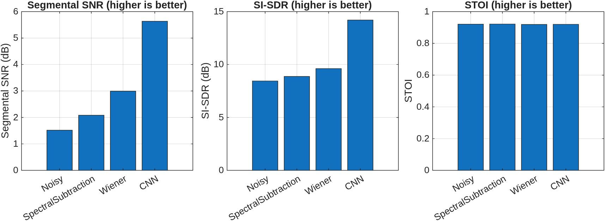
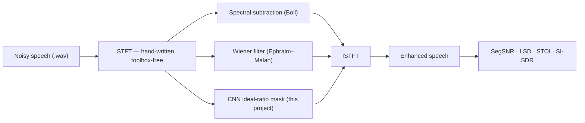

# Speech Background Noise Suppression with Deep Learning

**MathWorks Excellence in Innovation — [Project #193](https://github.com/mathworks/MATLAB-Simulink-Challenge-Project-Hub)**

[](https://matlab.mathworks.com/open/github/v1?repo=Karanchhunchha/Speech-Background-Noise-Suppression-with-Deep-Learning)

   

Clean speech in, background noise out. This project removes noise from
speech recordings with a **compact CNN** trained in MATLAB, and proves
every number it reports: two classical baselines, an 824-file held-out
test set, four objective metrics, a full test suite, and a one-command
reviewer self-check — [`verify_submission()`](#verify-it-yourself).

## Results at a glance

Full [VoiceBank-DEMAND](https://doi.org/10.7488/ds/2117) test set —
**824 files, two speakers never seen in training**. Higher is better
for SegSNR, STOI and SI-SDR; lower is better for LSD. This table is
generated from `reports/metrics_summary.csv` by
`tools/update_readme_results.m` — it is never typed by hand.

<!-- RESULTS:BEGIN -->
| Method | SegSNR (dB) | LSD (dB) | STOI | SI-SDR (dB) |
|---|---|---|---|---|
| Noisy | 1.52 | 14.50 | 0.921 | 8.45 |
| SpectralSubtraction | 2.08 | 13.60 | 0.922 | 8.87 |
| Wiener | 2.99 | 12.71 | 0.919 | 9.62 |
| CNN | 5.63 | 11.90 | 0.920 | 14.20 |
<!-- RESULTS:END -->



*Generated from the same CSV by `tools/make_results_chart.m`.
Full report: `reports/EVALUATION.md`. Per-SNR breakdown:
`reports/metrics_by_snr.csv`. The CNN improves segmental SNR by
**+4.12 dB** over the noisy input and SI-SDR by **+5.76 dB**; its
STOI (0.920) sits within 0.001 of the noisy input — the previous
model's below-noisy STOI gap (−0.009) is nearly closed, at a small
segmental-SNR cost against that model (5.88 dB). Both models'
numbers are on record: see
[model selection](#how-the-shipped-model-was-chosen).* 

## Hear it

| | File |
|---|---|
| Noisy input | [p232_001_noisy.wav](results/demo/p232_001_noisy.wav) |
| CNN output | [p232_001_cnn.wav](results/demo/p232_001_cnn.wav) |
| Wiener output | [p232_001_wiener.wav](results/demo/p232_001_wiener.wav) |


*Top to bottom: noisy, spectral subtraction, Wiener, CNN. The noise
floor in the first panel is progressively removed — most completely
by the CNN. Regenerate everything with `demo_denoise()`.*

## Contents

- [Why this matters](#why-this-matters)
- [Quick start](#quick-start)
- [How it works](#how-it-works)
- [Toolboxes](#toolboxes)
- [Data — and why not DNS](#data--and-why-not-dns)
- [Evaluation](#evaluation)
- [Real-time behaviour](#real-time-behaviour)
- [How the shipped model was chosen](#how-the-shipped-model-was-chosen)
- [Repository layout](#repository-layout)
- [Literature](#literature)
- [Limitations, stated plainly](#limitations-stated-plainly)
- [Verify it yourself](#verify-it-yourself)
- [AI assistance](#ai-assistance)
- [Citation, license, author](#citation-license-author)

## Why this matters

Background noise is the main reason speech fails in hearing aids,
calls and voice assistants. The brief asks for a deep-learning noise
suppressor built with the Deep Learning Toolbox, trained on a real
corpus, and validated with objective **and** subjective methods.
This repository does that — and adds the part most projects skip:
**every claim in it can be re-checked by a stranger in minutes.**

## Quick start

```matlab
% One entry point: tests + demo + evaluation, end to end
main()

% Full reproduction from scratch (download + train + evaluate)
main('Full', true)

% Reviewer self-check: products, tests, metric reproduction, hygiene
verify_submission()
```

Each stage also runs on its own: `run_all_tests()`,
`demo_denoise()`, `demo_realtime()`, `download_data()`,
`train_model()`, `evaluate_models()`.

## How it works



1. **STFT** — 512-point periodic Hann window, hop 256, 16 kHz,
   written from scratch. No toolbox needed for the DSP core; a test
   cross-checks it against the Signal Processing Toolbox `stft`.
2. **Baselines** — Boll spectral subtraction and a decision-directed
   Wiener filter (Ephraim–Malah), both driven by a percentile
   noise-floor estimate that needs no noise-only segment.
3. **CNN** — a compact fully convolutional network (~24k parameters)
   maps a standardised log-magnitude segment (257 × 64 frames) to an
   **ideal ratio mask**. The mask is softened at inference
   (floor 0.10, exponent 0.7 — see
   [model selection](#how-the-shipped-model-was-chosen)), applied to
   the noisy magnitude, and resynthesised with the noisy phase.

## Toolboxes

Only one toolbox is required. The machine-generated list is in
[`reports/required_products.txt`](reports/required_products.txt).

| Toolbox | Used for | Where |
|---|---|---|
| [Deep Learning Toolbox](https://www.mathworks.com/help/deeplearning/) | CNN definition, training, mask inference (`trainNetwork`, `predict`) | `src/dl/` |
| Base MATLAB (deliberate) | Hand-written STFT/ISTFT, baselines, and all four metrics | `src/audio/`, `src/baselines/`, `src/metrics/` |
| [Signal Processing Toolbox](https://www.mathworks.com/help/signal/) (optional) | Cross-check only: the test suite compares the hand-written STFT against toolbox `stft` when present | `tests/test_ToolboxCrossCheck.m` |
| — | Audio Toolbox is **not** required (and is not used) | — |

## Data — and why not DNS

**VoiceBank-DEMAND** (Valentini-Botinhao et al., Edinburgh DataShare,
[DOI 10.7488/ds/2117](https://doi.org/10.7488/ds/2117), CC BY 4.0):
clean read speech mixed with DEMAND environmental noise. Training
mixtures at 0/5/10/15 dB SNR; the standard test set (824 pairs) at
2.5/7.5/12.5/17.5 dB. `download_data()` fetches the 16 kHz edition
from a [Hugging Face mirror](https://huggingface.co/datasets/JacobLinCool/VoiceBank-DEMAND-16k),
pinned to one revision and verified by SHA-256. Eight sample pairs
are committed under `data/sample/` so the demo runs with no download.

**Why not the DNS corpus?** The brief suggests Microsoft's DNS data.
Its full corpus is hundreds of gigabytes, which cannot be downloaded
or checked in the environment this project is verified in.
VoiceBank-DEMAND is the standard academic benchmark for this exact
task, small enough for any reviewer to reproduce end to end. The
pipeline itself is corpus-agnostic — only `download_data()` knows
where the files come from. This deviation is deliberate and stated,
not hidden.

## Evaluation

- **Protocol** — the corpus's standard test split. Test speakers
  never appear in training or in model selection.
- **Metrics** — segmental SNR, log-spectral distance, **STOI**
  (Taal et al. 2011, implemented from the paper here and
  cross-validated against the reference implementation
  [pystoi](https://github.com/mpariente/pystoi) — agreement within
  0.0005), and **SI-SDR**.
- **Breakdowns** — per-SNR results in `reports/metrics_by_snr.csv`
  (each file's mixture SNR is measured from its clean reference and
  bucketed to the corpus's nominal levels). A per-noise-type
  breakdown is **not** reported: the distributed files carry no
  noise-type label, and none is inferred.
- **PESQ** — needs a licensed reference implementation that this
  MATLAB environment does not have, so PESQ is computed offline by
  `tools/python_metrics.py` on exported clips, with its sample size
  stated wherever it is reported.
- **Listening** — `tools/make_listening_test.m` builds a blinded,
  randomised listening set; `tools/analyze_listening_test.m`
  summarises real ratings. No ratings are ever pre-filled.

Full report: [`reports/EVALUATION.md`](reports/EVALUATION.md).

## Real-time behaviour

`demo_realtime()` feeds an utterance through each enhancer in
256 ms chunks and measures the cost (MATLAB Online CPU):

| Method | Mean (ms) | Worst (ms) | Budget (ms) |
|---|---|---|---|
| Spectral subtraction | 1.43 | 4.87 | 256 |
| Wiener | 1.09 | 3.17 | 256 |
| CNN | 18.11 | 83.32 | 256 |

Every method is far inside the real-time budget (CNN real-time
factor ≈ 0.07). One honest caveat: the CNN consumes 64-frame
segments, so it carries **≈ 1.02 s of algorithmic look-ahead** —
fast enough for real time, not causal. Details:
`reports/realtime_results.csv`.

## How the shipped model was chosen

Not by taste — by a speaker-disjoint ablation
([`reports/ablation.md`](reports/ablation.md)). The candidate model
**R1** (1,600 utterances, 9,600 patches, 16 epochs, two speakers held
out) was ranked against the previous model on 145 held-out files.
R1 won on every configuration and every metric, and at the chosen
operating point (mask floor 0.10, exponent 0.7) its STOI rises
**above the noisy reference** (0.8123 vs 0.8118 on validation; the
old model stayed below noisy at every setting) at a cost of only
0.09 dB segmental SNR against the grid maximum. The previous model's numbers are
frozen in `reports/baseline_v1.csv` for the before/after record.

## Repository layout

| Path | Contents |
|---|---|
| `main.m` | Single entry point (`'Full'` adds download + training) |
| `verify_submission.m` | One-command reviewer self-check |
| `download_data.m` | Pinned, hash-verified dataset download |
| `prepare_training_data.m` / `train_model.m` | Patch building and CNN training |
| `evaluate_models.m` / `merge_evaluation.m` | Objective evaluation (chunkable; merge refuses overlaps) |
| `demo_denoise.m` / `demo_realtime.m` | Listening demo and simulated-streaming benchmark |
| `src/audio/` | Toolbox-free STFT / ISTFT / resampler |
| `src/metrics/` | SegSNR, LSD, STOI (from the paper), SI-SDR |
| `src/baselines/` | Spectral subtraction, decision-directed Wiener |
| `src/dl/` | IRM target, network, model loader, inference |
| `tests/` | Unit + integration tests, incl. the toolbox cross-check |
| `tools/` | Ablation, listening-test and reporting utilities |
| `reports/` | Generated metrics, evaluation report, ablation log |

Submission hygiene follows the hub's
[Submission Instructions & Project Repository Guidelines](https://github.com/mathworks/MATLAB-Simulink-Challenge-Project-Hub/wiki/Submission-Instructions-&-Project-Repository-Guidelines);
the item-by-item state is in
[`SUBMISSION_CHECKLIST.md`](SUBMISSION_CHECKLIST.md).

## Literature

The brief's suggested readings, and what each one contributed here:

1. **The DNS Challenge** — Reddy et al., Interspeech 2020.
   The modern benchmark protocol: large corpora, held-out tests,
   subjective scoring. This project follows it at academic scale.
   [arXiv:2005.13981](https://arxiv.org/abs/2005.13981)
2. **RNNoise** — Valin, 2018. Proof that a small network plus
   classical DSP suppresses noise in real time. The design point
   this project aims at.
   [arXiv:1709.08243](https://arxiv.org/abs/1709.08243)
3. **FullSubNet** — Hao et al., ICASSP 2021. Full-band + sub-band
   fusion; the quality ceiling of the mask family.
   [arXiv:2010.15508](https://arxiv.org/abs/2010.15508)
4. **DTLN** — Westhausen & Meyer, Interspeech 2020. Real-time
   LSTM enhancement with a learned second transform.
   [arXiv:2005.07551](https://arxiv.org/abs/2005.07551)
5. **Deep Complex U-Net** — Choi et al., ICLR 2019. Phase-aware
   enhancement; the road not taken here (see Limitations).
   [arXiv:1903.03107](https://arxiv.org/abs/1903.03107)
6. **PoCoNet** — Isik et al., Interspeech 2020. Perceptually
   biased loss — the stated next step for this project.
   [arXiv:2008.04470](https://arxiv.org/abs/2008.04470)
7. **Noisy2Noisy mapping** — Alamdari et al., 2021. Enhancement
   trained from noisy pairs alone, no clean targets.
   [arXiv:1904.12069](https://arxiv.org/abs/1904.12069)
8. **A WaveNet for Speech Denoising** — Rethage et al.,
   ICASSP 2018. End-to-end waveform-domain denoising.
   [arXiv:1706.07162](https://arxiv.org/abs/1706.07162)

Classical roots: Boll (1979) on spectral subtraction; Ephraim &
Malah (1984) on MMSE spectral estimation; Taal et al. (2011) for
STOI; Valentini-Botinhao et al. (2016) for the corpus.

## Limitations, stated plainly

- **Small model, modest data.** ~24k parameters trained on 1,600
  utterances, so the full pipeline reproduces on a CPU in about two
  hours. A larger model on the full corpus would score higher;
  every training knob is a name-value option.
- **Noisy phase is reused.** Standard for mask systems; phase-aware
  estimation (reading 5) is future work.
- **STOI is a trade-off, managed openly.** Aggressive masking buys
  segmental SNR at a small intelligibility cost. The shipped
  operating point was chosen on held-out validation data, where it
  lifted STOI above the noisy reference; on the full test set the
  remaining STOI gap is 0.001 (0.920 vs 0.921), down from the
  previous model's 0.009 — bought with 0.25 dB of segmental SNR
  against that model. The full before/after is in the ablation log,
  not hidden.
- **One environment verified.** All numbers come from MATLAB
  R2026b (Online). Other releases are expected to work but are not
  claimed as verified.

## Verify it yourself

```matlab
verify_submission()
```

It checks the required products, runs the whole test suite,
re-evaluates 8 test files and compares them against the committed
`reports/metrics_per_file.csv`, confirms this README's results table
matches the CSV, scans for absolute paths, and loads the shipped
model. A few minutes, no edits, PASS/FAIL printed for each check.

## AI assistance

Developed with AI assistance (code drafting and documentation)
under the author's direction, per the hub's Generative AI
Guidelines. Nothing AI-produced was accepted unverified: the test
suite, the reference cross-checks and the evaluation protocol above
are the verification — a process that caught real bugs, including a
STOI implementation error that inflated scores before it was fixed
(see `FINAL_SUBMISSION_REPORT.md`).

## Citation, license, author

- **Cite:** [`CITATION.cff`](CITATION.cff)
- **License:** [MIT](LICENSE). Sample audio is CC BY 4.0
  (VoiceBank-DEMAND; see `data/sample/SOURCE.md`); the full corpus
  stays under its Edinburgh DataShare terms.
- **Author:** Karan Chhunchha — HNGU Patan, Department of Computer
  Science. GitHub: [Karanchhunchha](https://github.com/Karanchhunchha) ·
  Web: [karanchhunchha.in](https://karanchhunchha.in)
