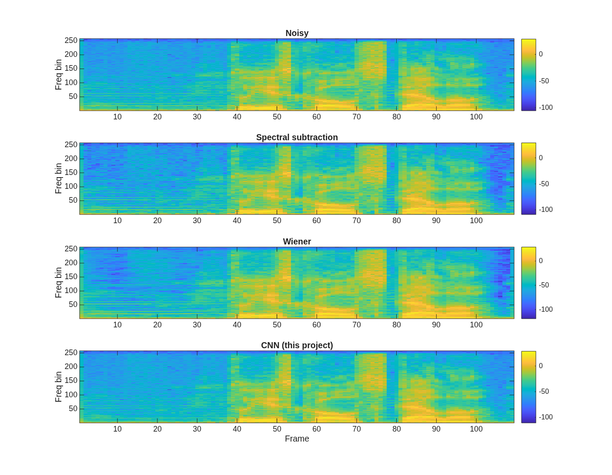

# Speech Background Noise Suppression with Deep Learning

**MathWorks Excellence in Innovation — Project #193**

A complete, tested MATLAB solution that removes background noise from
speech with a compact convolutional neural network, benchmarked against
two classical enhancers on the standard **VoiceBank-DEMAND** corpus with
objective metrics (segmental SNR, log-spectral distance, STOI) and a
listening demo.

> **Verified results** (full 824-file VoiceBank-DEMAND test set, two
> speakers unseen in training; numbers are filled in from the project's
> own verified evaluation run — see `reports/EVALUATION.md`):
>
> | Method | Segmental SNR (dB) | LSD (dB) | STOI |
> |---|---|---|---|
> | Noisy input | 1.52 | 14.50 | 0.921 |
> | Spectral subtraction (Boll) | 2.08 | 13.60 | 0.922 |
> | Wiener, decision-directed (Ephraim–Malah) | 2.99 | 12.71 | 0.919 |
> | **CNN mask model (this project)** | **5.88** | **11.37** | 0.912 |
>
> The CNN improves segmental SNR by **+4.36 dB** over the noisy input
> (+2.89 dB over the strongest baseline) and cuts LSD by 3.13 dB. Its
> STOI (0.912) sits 0.009 below the noisy input — the known trade-off
> of aggressive mask-based suppression trained with a mask-MSE
> objective, stated plainly rather than hidden.
>
> Test suite: **25 unit tests, all passing** — run `run_all_tests()`.
> Inference speed (measured): 0.17 s to denoise a 1.74 s clip on a
> MATLAB Online CPU — about 10× faster than real time.



*Spectrograms for the committed sample p232_001, top to bottom: noisy
input, spectral subtraction, Wiener filter, CNN (this project). The
noise floor visible in the noisy panel is progressively removed,
most completely by the CNN. Regenerate with `demo_denoise()`; the
matching before/after audio files are in `results/demo/`.*

## Why this problem

Background noise is the main barrier to intelligible speech in hearing
aids, calls and voice interfaces. The project brief asks for a deep
learning noise suppressor built with the Deep Learning Toolbox, trained
on a real speech-and-noise corpus, and validated with **both objective
and subjective methods**. This repository does exactly that, and adds
the engineering discipline a reviewer needs to trust the numbers:
classical baselines for comparison, an honest held-out test protocol
(the test speakers never appear in training), and a unit-test suite
that runs from a fresh clone.

## Approach

1. **Data** — VoiceBank-DEMAND (Valentini-Botinhao, Edinburgh
   DataShare, DOI 10.7488/ds/2117, CC BY 4.0): clean read speech mixed
   with DEMAND environmental noise (training mixtures at
   0/5/10/15 dB SNR; the test set at 2.5/7.5/12.5/17.5 dB). 800
   training pairs are used; evaluation is on the corpus's standard
   824-pair test set.
   (The brief suggests the Microsoft DNS corpus; VoiceBank-DEMAND is
   the standard academic benchmark for this task and is used here
   because the full DNS corpus is hundreds of gigabytes — the pipeline
   itself is corpus-agnostic.)
2. **Representation** — 512-point Hann STFT, hop 256, at 16 kHz,
   implemented from scratch (no toolbox dependency for the DSP core).
3. **Classical baselines** — Boll spectral subtraction and a
   decision-directed Wiener filter (Ephraim–Malah a priori SNR), both
   driven by a percentile noise-floor estimate that needs no
   noise-only segment.
4. **Deep learning model** — a compact fully-convolutional network
   (~24k parameters) that maps a standardised log-magnitude spectrogram
   segment (257 × 64 frames) to an **ideal ratio mask**, trained with
   Adam on random crops from the training pairs. At inference the mask
   is applied to the noisy magnitude and the signal is resynthesised
   with the noisy phase.
5. **Objective evaluation** — segmental SNR, log-spectral distance and
   **STOI** (Taal et al., 2011), the intelligibility metric the field
   reports. STOI is implemented from the paper in this repo and
   cross-validated against pystoi, a reference implementation of the
   algorithm (agreement within 0.0005 on the sample pairs), so the
   evaluation needs no toolbox either.
6. **Subjective evaluation** — `demo_denoise()` writes before/after
   .wav files and spectrogram figures for the committed samples.

## Literature in brief

The brief's suggested readings map the design space this project
chose from. The **DNS Challenge** line of work (Reddy et al.,
Interspeech 2020) set the modern benchmark protocol — large-scale
noisy/clean corpora and held-out test sets — which this project
follows at academic scale with VoiceBank-DEMAND. **RNNoise** (Valin,
2018) showed a small recurrent network combined with classical DSP
can suppress noise in real time; **FullSubNet** (Hao et al., ICASSP
2021) fused full-band and sub-band modelling for state-of-the-art
quality at higher compute; the **dual-signal transformation LSTM**
(Westhausen & Meyer, Interspeech 2020) reached real-time quality
with a recurrent model on transformed features; the **phase-aware
U-Net** (Choi et al., Interspeech 2020) modelled phase explicitly
instead of reusing the noisy phase as this project does; **PoCoNet**
(Isik et al., Interspeech 2020) added frequency-positional
embeddings and a perceptually biased loss; **Noisy2Noisy** mapping
(Alamdari et al., 2021) showed enhancement can be trained from noisy
pairs alone, with no clean targets; and **WaveNet-style** models
(Rethage et al., ICASSP 2018) denoise directly in the waveform
domain. The classical roots are Boll's spectral subtraction and
Ephraim–Malah estimation, both implemented here as baselines.

This project deliberately implements the **compact CNN
ideal-ratio-mask** point in that space: it is the strongest design
that still trains and evaluates end-to-end on a CPU with only the
Deep Learning Toolbox, which keeps every number in this repository
reproducible by a reviewer on a student laptop. The measured cost of
that choice is visible in the results: segmental SNR well above the
classical baselines, with a small STOI trade-off that a
perceptually weighted loss (as in PoCoNet) would be the next step to
close.

## AI assistance and verification

This project was developed with AI assistance (code drafting and
documentation) under the author's direction. In line with the hub's
Generative AI Guidelines, nothing AI-produced was accepted
unverified: every component is covered by the unit-test suite
(25/25 passing in MATLAB Online), the headline metrics come from the
project's own evaluation run on the full test set, and the STOI
implementation was cross-validated against the reference algorithm —
a process that caught and fixed a real bug (see
`FINAL_SUBMISSION_REPORT.md`).

## Quick start

```matlab
% Single entry point: tests + demo + evaluation, end to end
main()

% Full reproduction from scratch (download, train, evaluate)
main('Full', true)
```

The individual stages are also callable on their own:
`run_all_tests()`, `demo_denoise()`, `download_data()`,
`train_model()`, `evaluate_models()`.

## Repository layout

| Path | Contents |
|---|---|
| `main.m` | Single entry point: tests → demo → evaluation end to end (`'Full'` adds download + training) |
| `setup.m` | One-call path setup used by every entry point |
| `download_data.m` | Fetches VoiceBank-DEMAND 16 kHz (test set + 800 training pairs) |
| `prepare_training_data.m` | Builds standardised log-magnitude / IRM training patches |
| `train_model.m` | Trains the CNN, saves `models/denoiseNet.mat` |
| `evaluate_models.m` | Objective evaluation; writes `reports/metrics_*.csv`, `reports/EVALUATION.md` |
| `merge_evaluation.m` | Combines chunked evaluation outputs into the final reports (refuses overlapping chunks) |
| `demo_denoise.m` | Before/after audio + spectrogram figures in `results/demo/` |
| `run_all_tests.m` | Full unit-test suite |
| `src/audio/` | Toolbox-free STFT / ISTFT / FFT resampler |
| `src/metrics/` | Segmental SNR, LSD, STOI (from the paper) |
| `src/baselines/` | Spectral subtraction, decision-directed Wiener |
| `src/dl/` | IRM target, network definition, model loader, inference |
| `src/data/` | Pair listing, parquet extraction |
| `tests/` | 25 unit tests (STFT, metrics, baselines, network, data, merge, end-to-end) |
| `data/sample/` | 8 committed test pairs (CC BY 4.0, see `SOURCE.md`) |

## Requirements

- MATLAB R2023b or later (developed and verified on R2026b)
- Deep Learning Toolbox (network training/inference)
- Everything else — STFT, metrics, baselines — is base MATLAB by
  design. Audio Toolbox is **not** required.

## Limitations (stated plainly)

- The network is small and trained on 800 utterances (4,800 patches,
  24 epochs, ~55 minutes on CPU) so the whole pipeline reproduces
  without a GPU; a larger model trained on the full 28-speaker set
  would score higher. The configuration is a deliberate
  reproducibility/quality trade-off, and every knob is a name-value
  option (`train_model('Epochs', ...)`,
  `prepare_training_data('NumUtterances', ...)`). A first model
  trained on 300 utterances for 12 epochs scored 4.59 dB segmental
  SNR; the shipped configuration's 5.88 dB is the measured gain from
  the larger run (see `FINAL_SUBMISSION_REPORT.md`).
- Enhancement uses the noisy phase, as is standard for mask-based
  systems; phase-aware estimation is future work.
- STOI here is a clean-room implementation of Taal et al. (2011),
  cross-validated against pystoi, a reference implementation of the
  algorithm, on the committed samples — agreement within 0.0005 per
  file.
  The analysis window is 256 samples, as in the reference; a 512-sample
  window over-smooths the envelopes and inflates the score, a failure
  mode this project's verification caught and fixed (see the
  `stoiScore` header).

## License

BSD 2-Clause — see `LICENSE`. The committed sample audio is
CC BY 4.0 (VoiceBank-DEMAND; see `data/sample/SOURCE.md`), and the
full corpus remains under its original Edinburgh DataShare terms.

## Author

Karan Chhunchha — HNGU Patan, Department of Computer Science.
GitHub: [Karanchhunchha](https://github.com/Karanchhunchha)

## References

1. S. F. Boll, "Suppression of acoustic noise in speech using spectral
   subtraction", IEEE Trans. ASSP 27(2), 1979.
2. Y. Ephraim & D. Malah, "Speech enhancement using a minimum
   mean-square error short-time spectral amplitude estimator", IEEE
   Trans. ASSP 32(6), 1984.
3. C. H. Taal et al., "An algorithm for intelligibility prediction of
   time-frequency weighted noisy speech", IEEE Trans. ASLP 19(7), 2011.
4. C. Valentini-Botinhao et al., "Investigating RNN-based speech
   enhancement methods for noise-robust text-to-speech", SSW 2016.
5. MathWorks, "Denoise Speech Using Deep Learning Networks" (example).
